# 15 fresh MFL website designs

Fifteen new directions, numbered **01–15 in this collection**. These explore different structures, typography and colour, rather than revisiting the previous retro and dark-dashboard concepts.

[View the PDF lookbook](MFL_Fresh_15_Lookbook.pdf) · [Download the offline gallery](https://github.com/NooksMFL/mfl-management-hub/raw/refs/heads/main/design-concepts/MFL_Fresh_15_Gallery.zip)

**In the Hub:** open **Design Studio** under **Community & design**, then choose **Fifteen new · Fresh directions**. Or [open Design Studio directly](https://mfl-management-app22.streamlit.app/?page=Design+Studio).

Each concept includes working navigation, a compact example squad, progression-period switching, player search, league filters, player profiles and retired-player visibility. All figures are clearly labelled illustrative data. The live Hub now uses **12 · Signal**, with smaller typography; these pages preserve the original design studies.

## Compare the designs

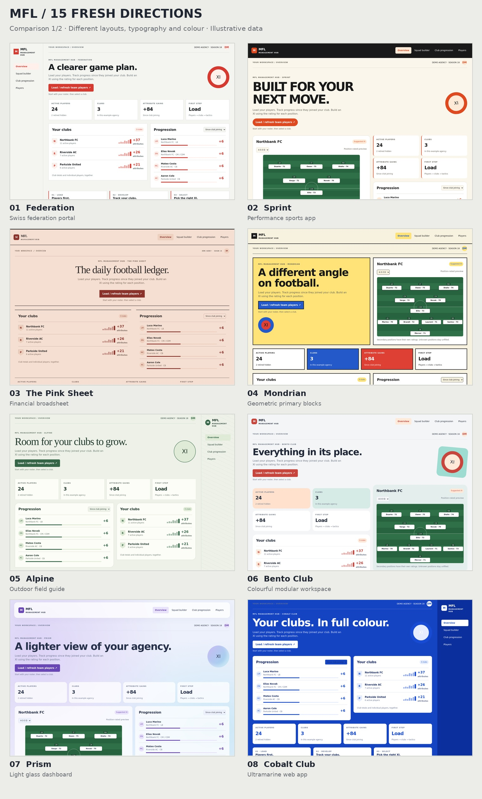

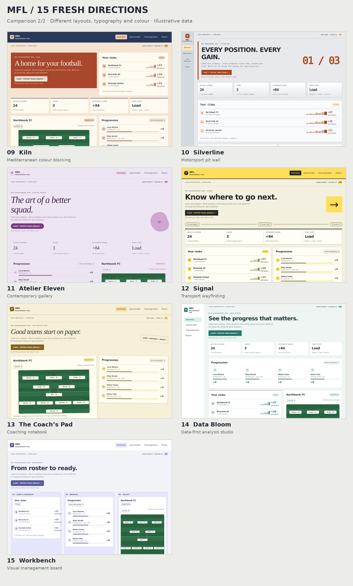

## The fifteen directions

| No. | Design | Direction |
|---|---|---|
| 01 | [Federation](previews/17-federation.png) | Swiss federation portal |
| 02 | [Sprint](previews/18-sprint.png) | Performance sports app |
| 03 | [The Pink Sheet](previews/19-pink-sheet.png) | Financial broadsheet |
| 04 | [Mondrian](previews/20-mondrian.png) | Geometric primary blocks |
| 05 | [Alpine](previews/21-alpine.png) | Outdoor field guide |
| 06 | [Bento Club](previews/22-bento.png) | Colourful modular workspace |
| 07 | [Prism](previews/23-prism.png) | Light glass dashboard |
| 08 | [Cobalt Club](previews/24-cobalt.png) | Ultramarine web app |
| 09 | [Kiln](previews/25-kiln.png) | Mediterranean colour blocking |
| 10 | [Silverline](previews/26-silverline.png) | Motorsport pit wall |
| 11 | [Atelier Eleven](previews/27-atelier.png) | Contemporary gallery |
| 12 | [Signal](previews/28-signal.png) | Transport wayfinding |
| 13 | [The Coach’s Pad](previews/29-playbook.png) | Coaching notebook |
| 14 | [Data Bloom](previews/30-data-bloom.png) | Data-first analysis studio |
| 15 | [Workbench](previews/31-workbench.png) | Visual management board |

## 01 · Federation

White, vermilion and precise typography. A slim left navigation and a disciplined operations grid.

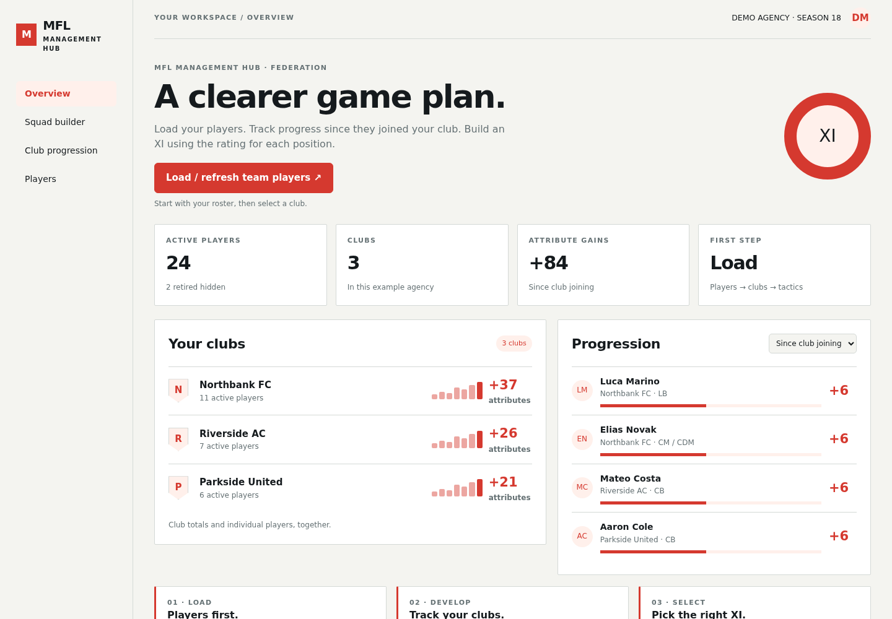

[Phone preview](previews/17-federation-mobile.png) · [HTML source](17-federation.html)

## 02 · Sprint

Oversized athletic headlines, tangerine panels and a horizontal race-strip navigation.

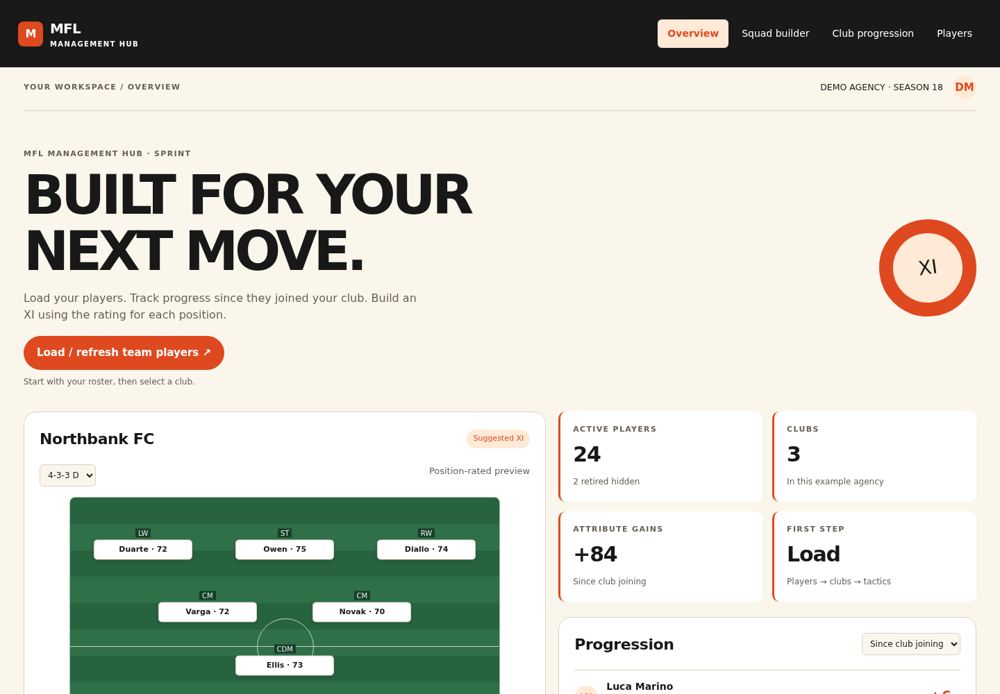

[Phone preview](previews/18-sprint-mobile.png) · [HTML source](18-sprint.html)

## 03 · The Pink Sheet

Salmon paper, ink rules and editorial columns. Football progression presented as a daily briefing.

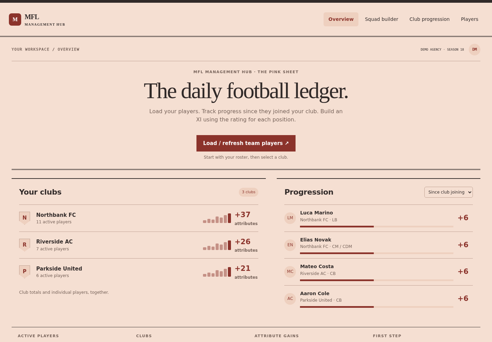

[Phone preview](previews/19-pink-sheet-mobile.png) · [HTML source](19-pink-sheet.html)

## 04 · Mondrian

Primary-colour rectangles, thick ink borders and a modular federation-style control surface.

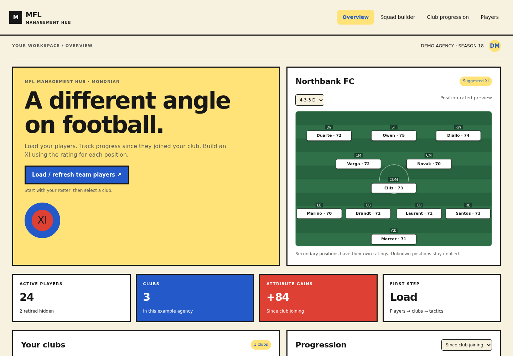

[Phone preview](previews/20-mondrian-mobile.png) · [HTML source](20-mondrian.html)

## 05 · Alpine

Sage and pine, generous type and a terrain-inspired side panel. Club progress becomes an expedition log.

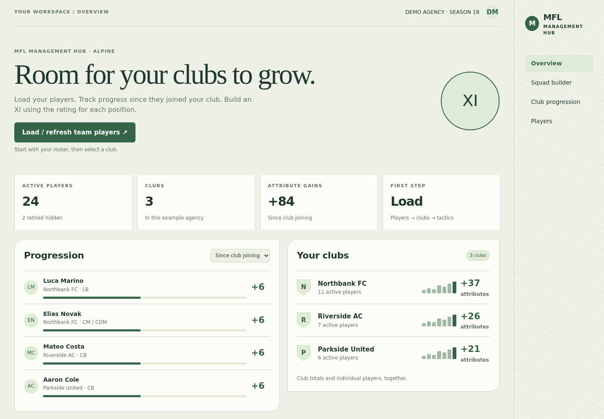

[Phone preview](previews/21-alpine-mobile.png) · [HTML source](21-alpine.html)

## 06 · Bento Club

Bright white, coral and aqua. A wide card canvas, small status chips and a different-sized tile for each job.

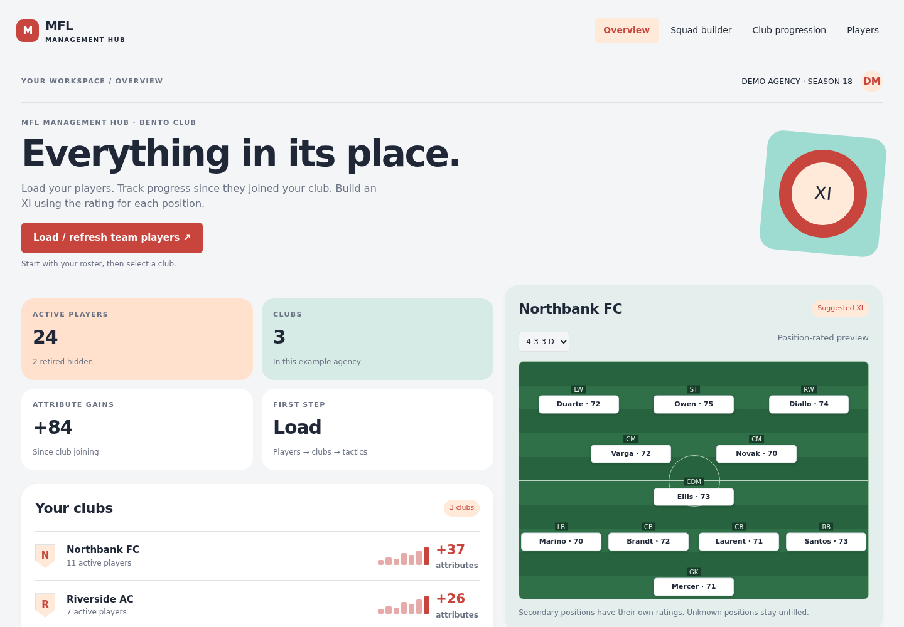

[Phone preview](previews/22-bento-mobile.png) · [HTML source](22-bento.html)

## 07 · Prism

A pale lilac and ice-blue mesh, translucent panels and a floating command dock. Light rather than luminous black.

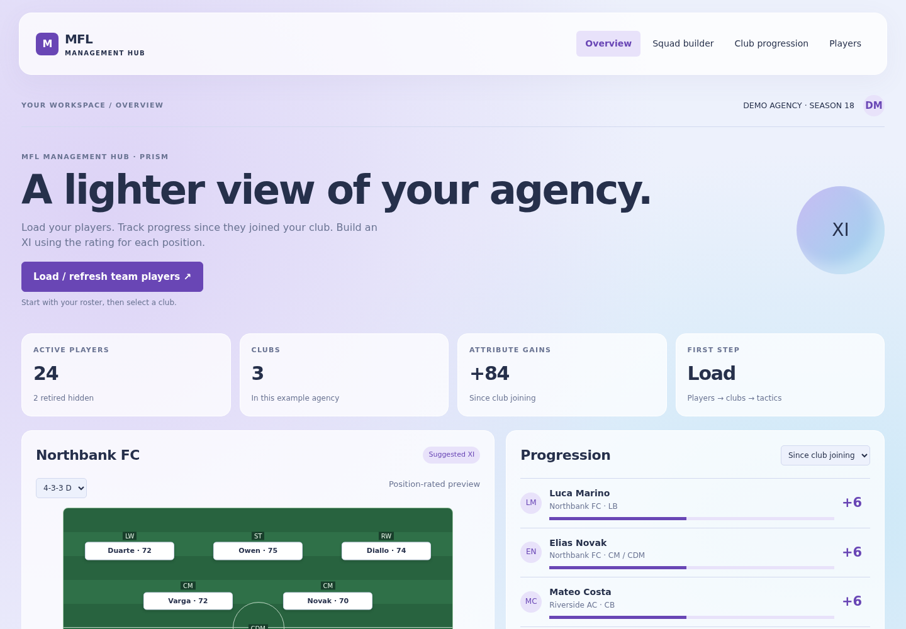

[Phone preview](previews/23-prism-mobile.png) · [HTML source](23-prism.html)

## 08 · Cobalt Club

An immersive blue canvas, high-contrast white panels and a compact right-hand utility rail.

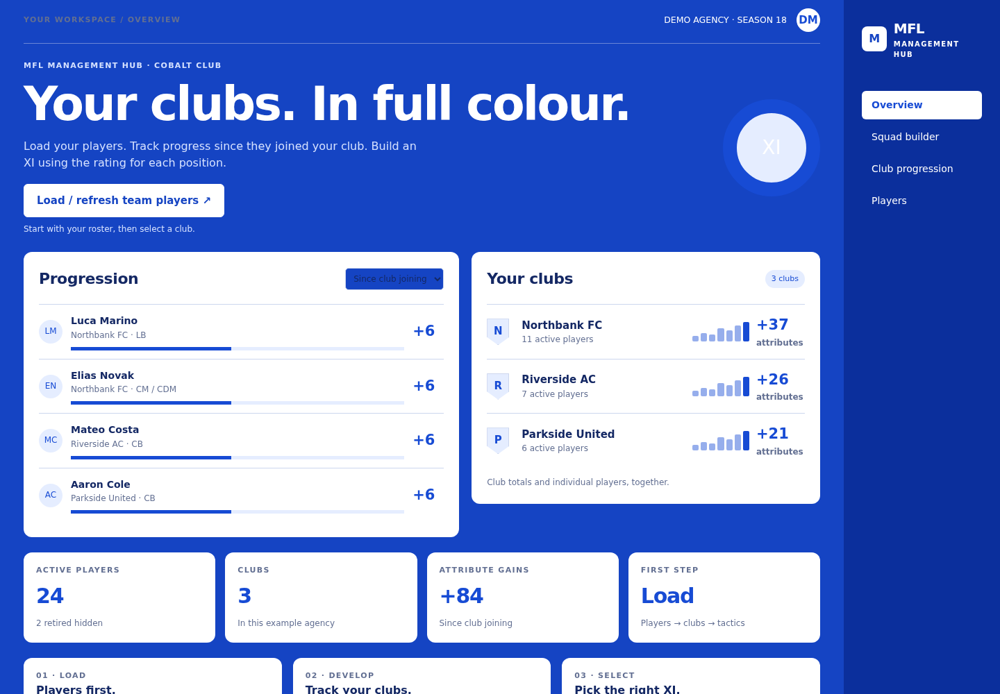

[Phone preview](previews/24-cobalt-mobile.png) · [HTML source](24-cobalt.html)

## 09 · Kiln

Terracotta, chalk and deep blue. A horizontal architectural composition with generous square sections.

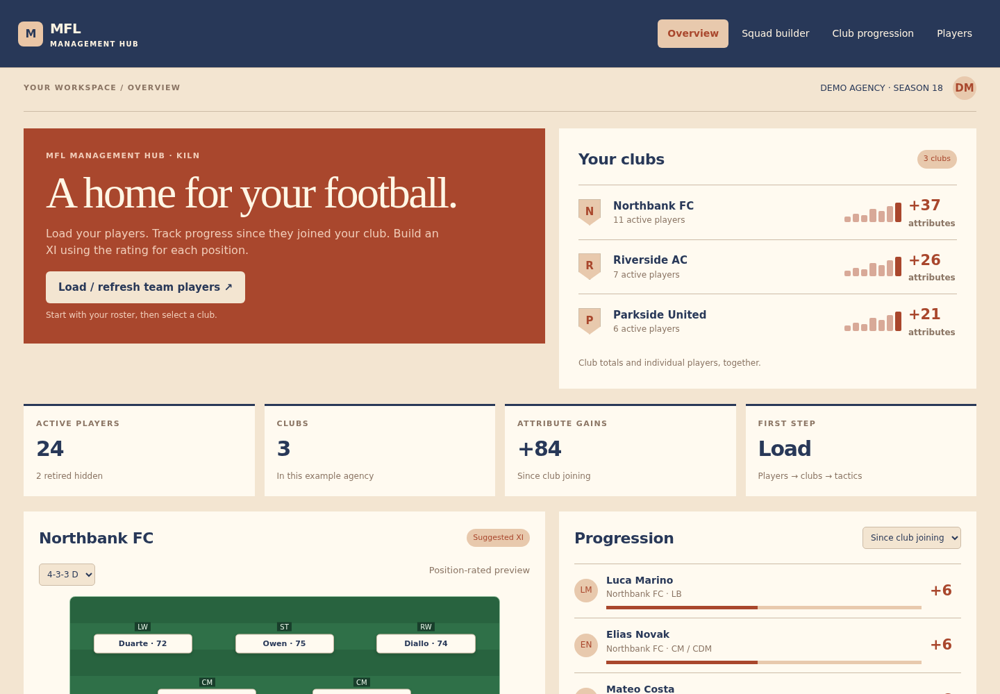

[Phone preview](previews/25-kiln-mobile.png) · [HTML source](25-kiln.html)

## 10 · Silverline

Cool aluminium, graphite and orange. A numbered navigation rail and a horizontal performance ledger.

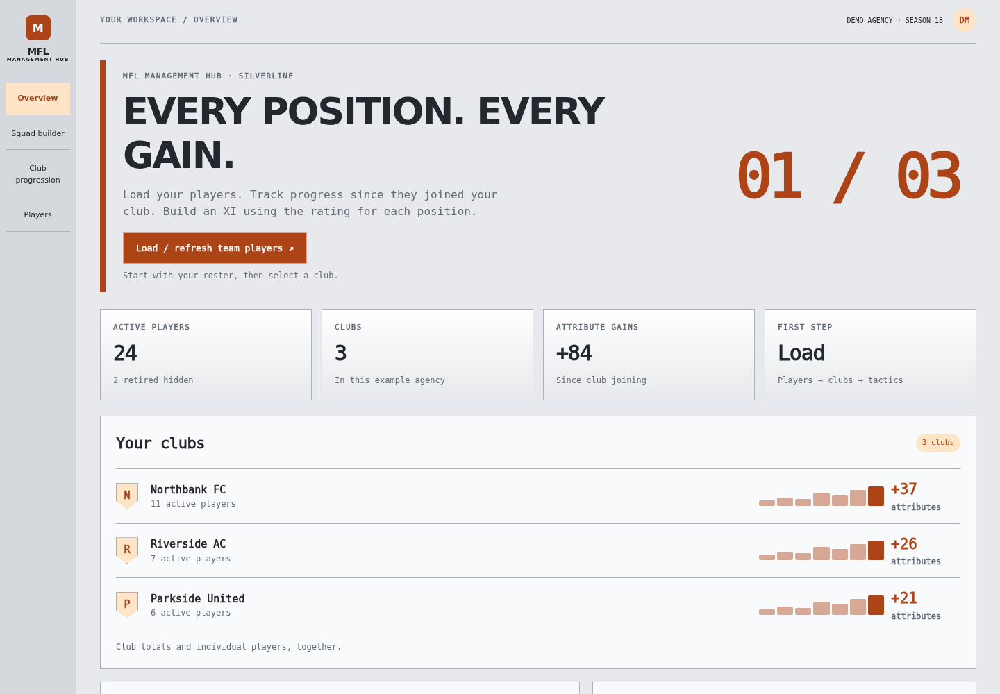

[Phone preview](previews/26-silverline-mobile.png) · [HTML source](26-silverline.html)

## 11 · Atelier Eleven

Lavender, plum and sculptural serif type. A large typographic masthead with a calm gallery grid.

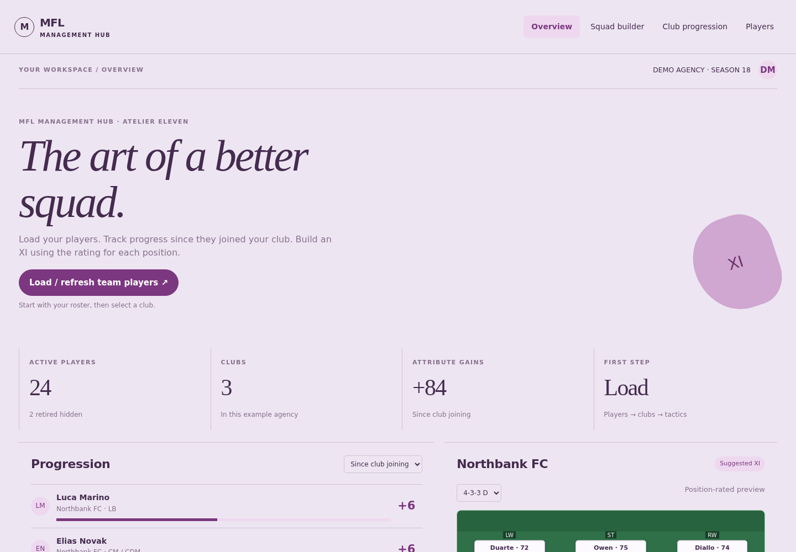

[Phone preview](previews/27-atelier-mobile.png) · [HTML source](27-atelier.html)

## 12 · Signal

Warm yellow and charcoal with route-like navigation. Big labels, compact boards and exceptionally clear wayfinding.

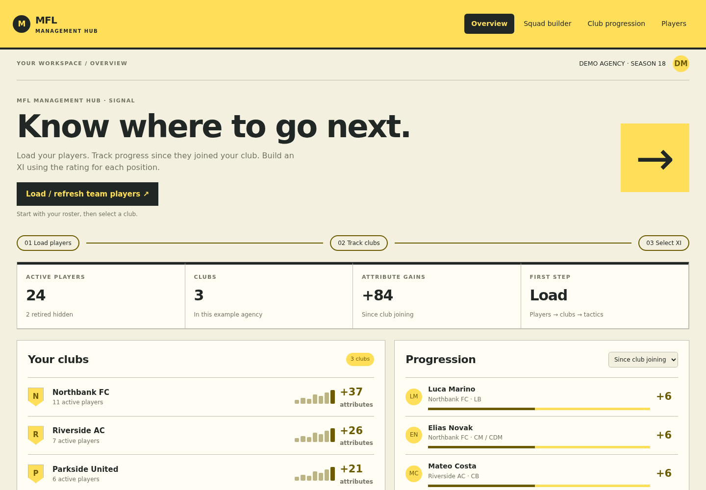

[Phone preview](previews/28-signal-mobile.png) · [HTML source](28-signal.html)

## 13 · The Coach’s Pad

Warm ivory, hand-drawn field marks and ochre tabs. A useful notebook rather than a software dashboard.

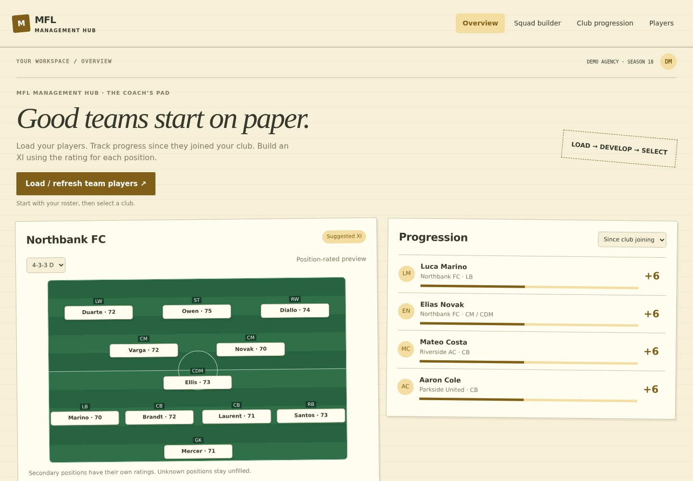

[Phone preview](previews/29-playbook-mobile.png) · [HTML source](29-playbook.html)

## 14 · Data Bloom

White and teal with rose heatmap cells. Progression tables lead the page and compact charts carry the story.

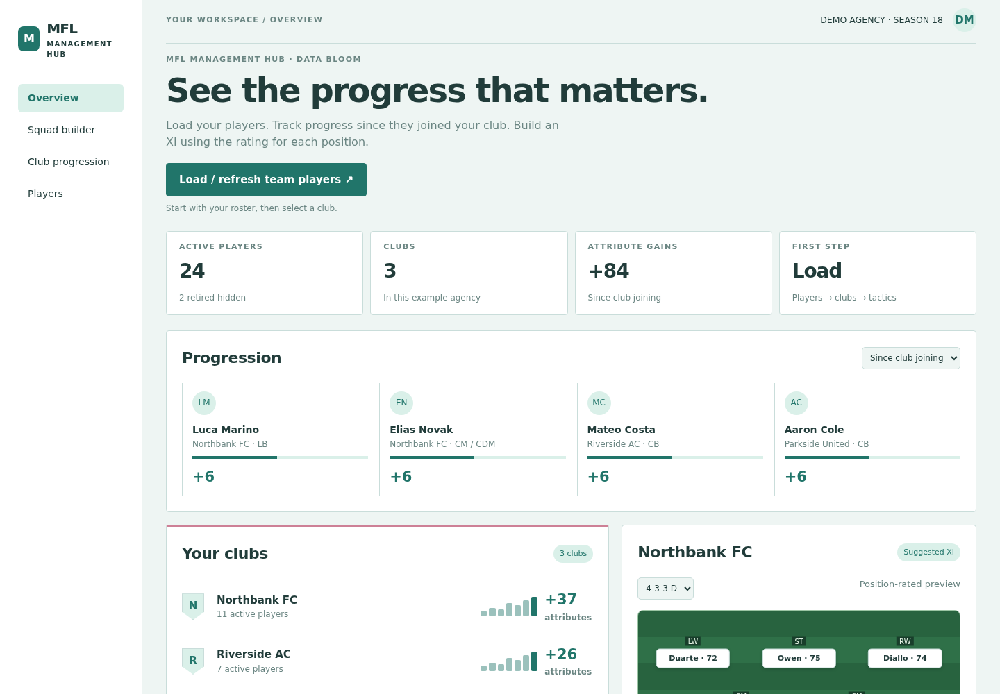

[Phone preview](previews/30-data-bloom-mobile.png) · [HTML source](30-data-bloom.html)

## 15 · Workbench

A bright indigo-and-white canvas with three working lanes: load, develop and select. Tasks lead, analytics follow.

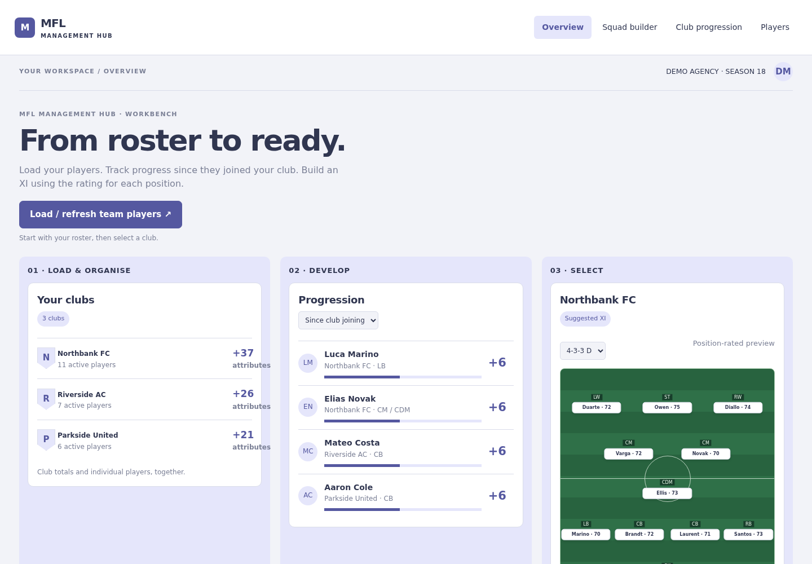

[Phone preview](previews/31-workbench-mobile.png) · [HTML source](31-workbench.html)

## Try the interactive versions

GitHub displays HTML source rather than running the previews. Use the Hub’s Design Studio, or download and extract the offline ZIP and open **fresh-index.html**. Local fonts are included, so no external font service is required.

Validation: all 15 checked at 1440 px desktop and 390 px mobile widths, including navigation, player profiles, search, league filters, retired-player toggles, progression periods and formation switching.
