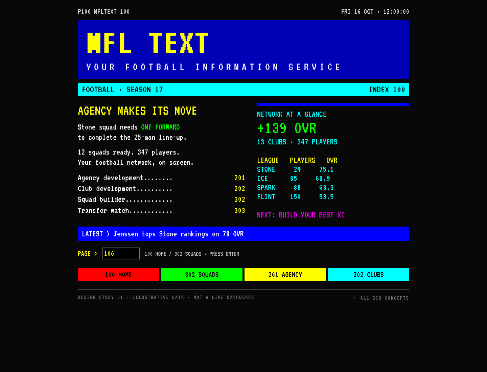
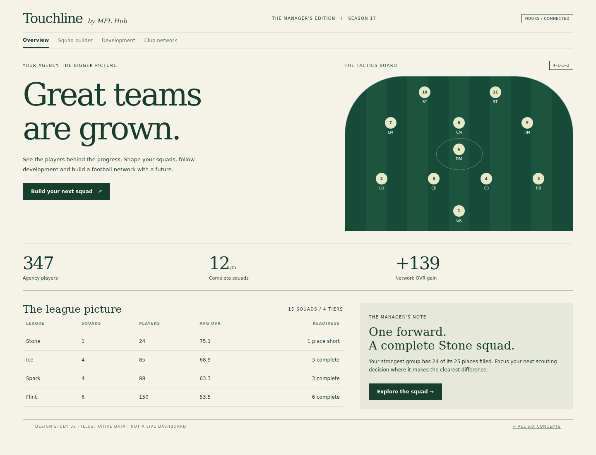
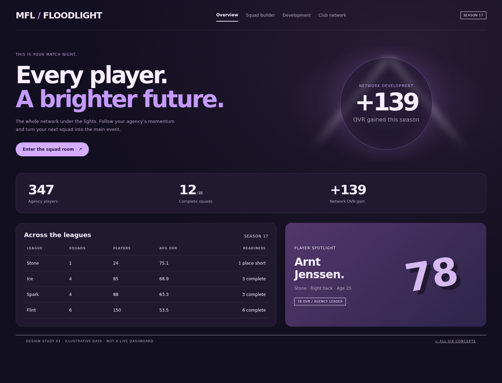
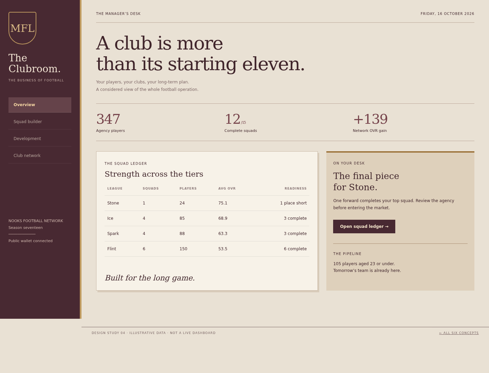
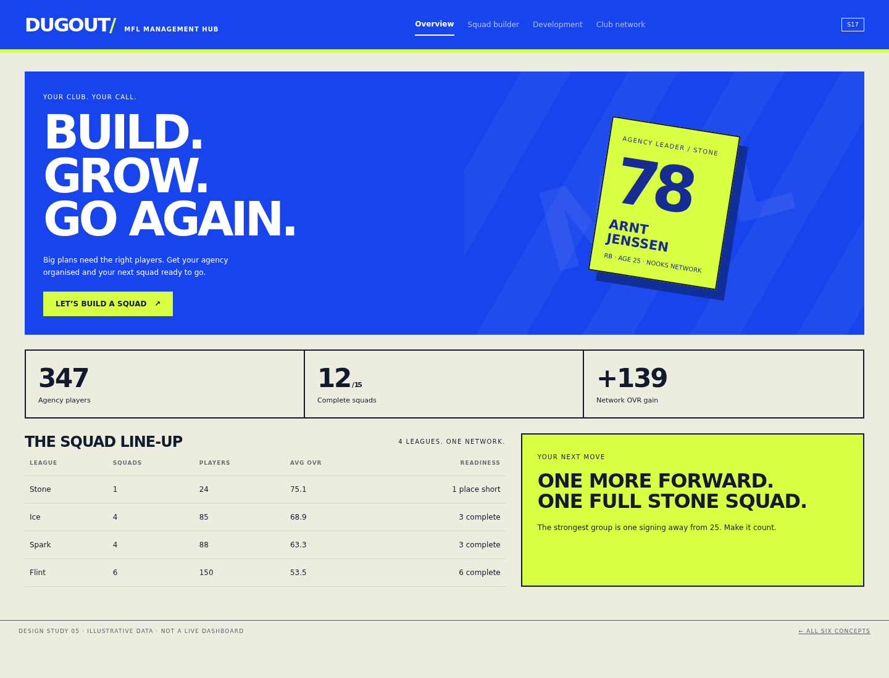
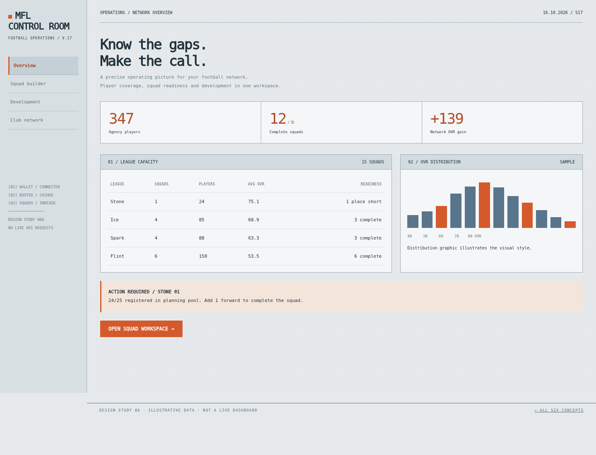

# MFL Hub — six design directions

**New: [ten wild new themes (07–16)](WILD_COLLECTION.md)** · [Wild collection PDF](MFL_Wild_Design_Lookbook.pdf)

Six alternative visual directions for review. Each has its own layout, background, typography and colours. The live Hub now includes a **Design Studio** preview section; the live theme is now Manager Workspace, while this gallery preserves the earlier design studies.

[Open the PDF lookbook](MFL_Design_Lookbook.pdf) · [Downloadable gallery archive](MFL_Design_Gallery.zip)

**Try in the Hub:** select **Design Studio** in the sidebar. The concept previews support squad navigation, league filtering and player search. Teletext also accepts page **302** for squads and **100** for home.

**Try offline:** download the gallery ZIP, extract it, then open `index.html`. GitHub shows HTML source rather than hosting these previews.

All dashboards use illustrative data. The existing application remains responsible for live sync, squad creation and formation editing.

## 01 · MFL Text

**UK teletext · 1988.** Black screens, primary colours, pixel typography and numbered football pages.

The nostalgic one. A proper football information service with keyboard page entry and Fastext-style navigation.

[Mobile preview](previews/01-teletext-mobile.png) · [HTML source](01-teletext.html)

## 02 · Touchline

**Modern sports editorial.** Ivory paper, forest green, oversized serif headlines and a tactical pitch.

A calm, premium football journal. Strong hierarchy and generous space make long sessions feel lighter.

[Mobile preview](previews/02-touchline-mobile.png) · [HTML source](02-touchline.html)

## 03 · Floodlight

**Match-night broadcast.** Aubergine, electric lilac, luminous stadium lights and a broadcast scoreboard.

A cinematic match-night experience with horizontal navigation and large, vivid performance graphics.

[Mobile preview](previews/03-floodlight-mobile.png) · [HTML source](03-floodlight.html)

## 04 · The Clubroom

**Heritage football club.** Warm stone, oxblood, brass accents and traditional serif typography.

A club secretary’s desk reimagined: restrained, confident and rooted in football heritage.

[Mobile preview](previews/04-clubroom-mobile.png) · [HTML source](04-clubroom.html)

## 05 · Dugout

**Bold sportswear.** Cobalt, acid yellow, sharp black lettering and oversized athletic typography.

An energetic football brand built around player cards, squad building and decisive actions.

[Mobile preview](previews/05-dugout-mobile.png) · [HTML source](05-dugout.html)

## 06 · Control Room

**Technical scouting console.** Cool grey, signal orange, monospaced data and engineering grid lines.

A detailed working tool for the analytical manager, with compact tables and clearly exposed squad gaps.

[Mobile preview](previews/06-control-mobile.png) · [HTML source](06-control.html)

## Asset licences

VT323 is bundled under its SIL Open Font License; see `assets/VT323-OFL.txt`. DejaVu fonts are bundled under their accompanying licence in `assets/DejaVu-LICENSE.txt`. No remote fonts, API keys or private wallet values are embedded.