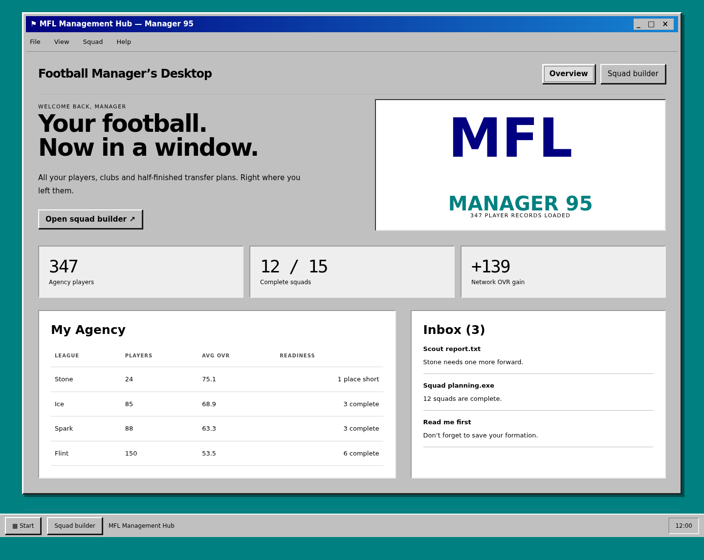
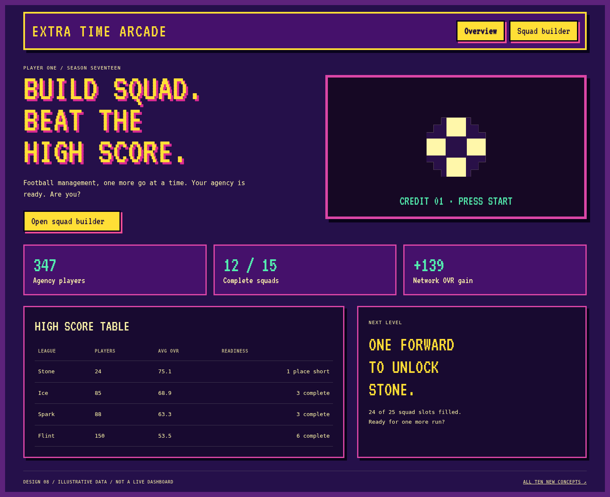
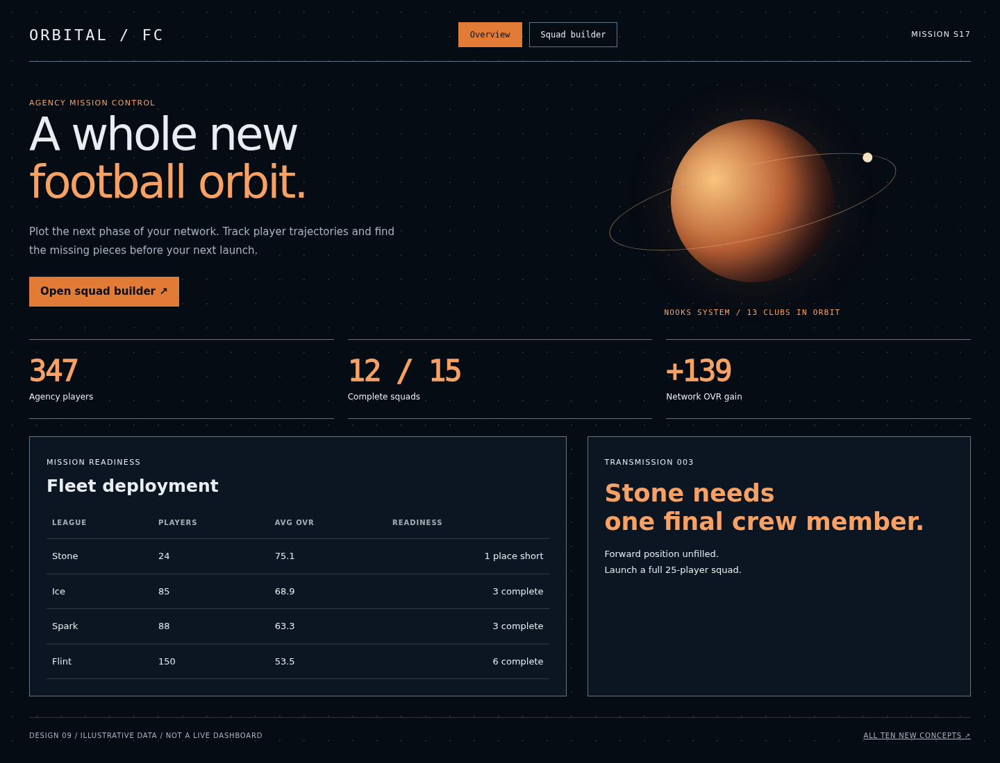
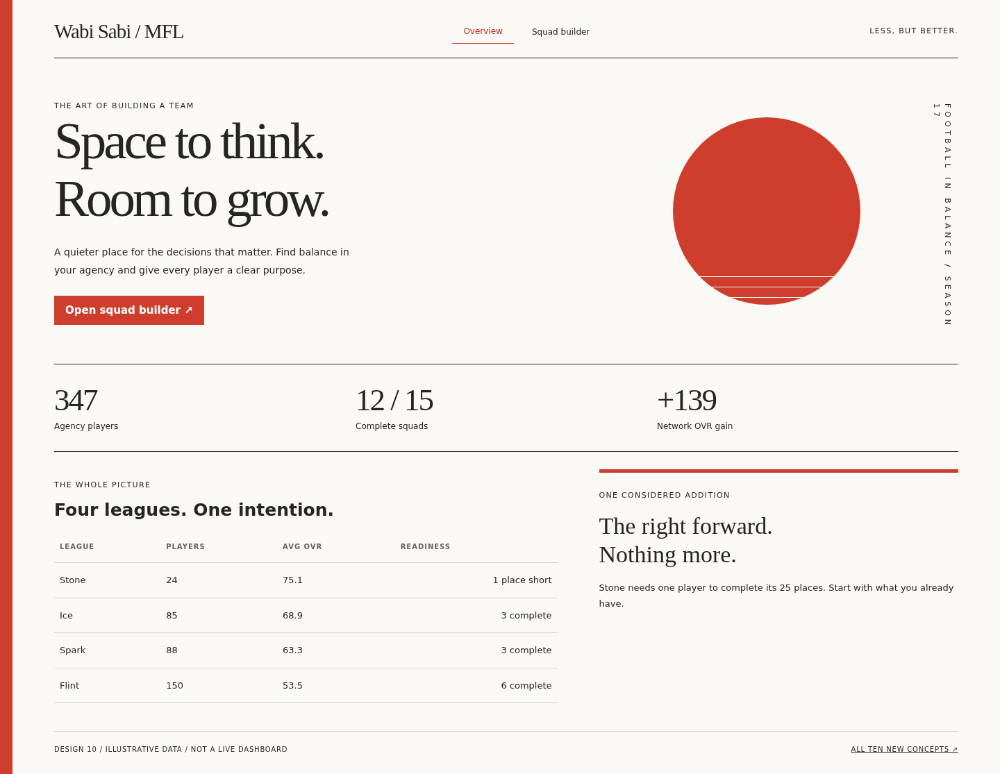
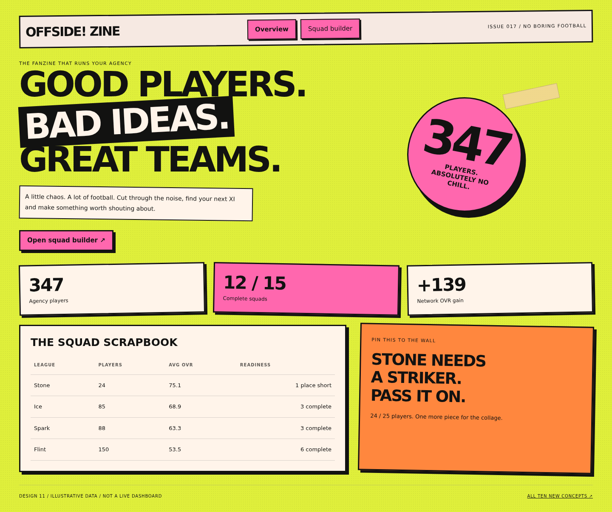
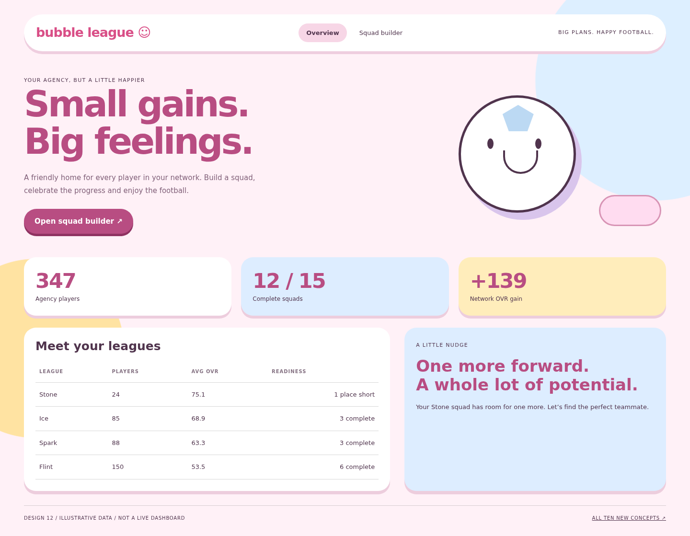
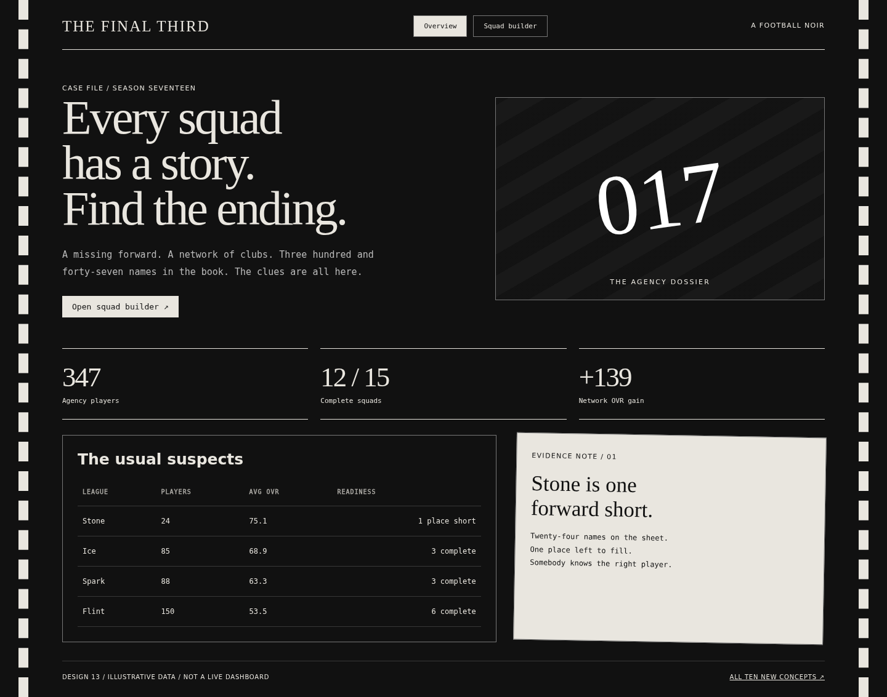
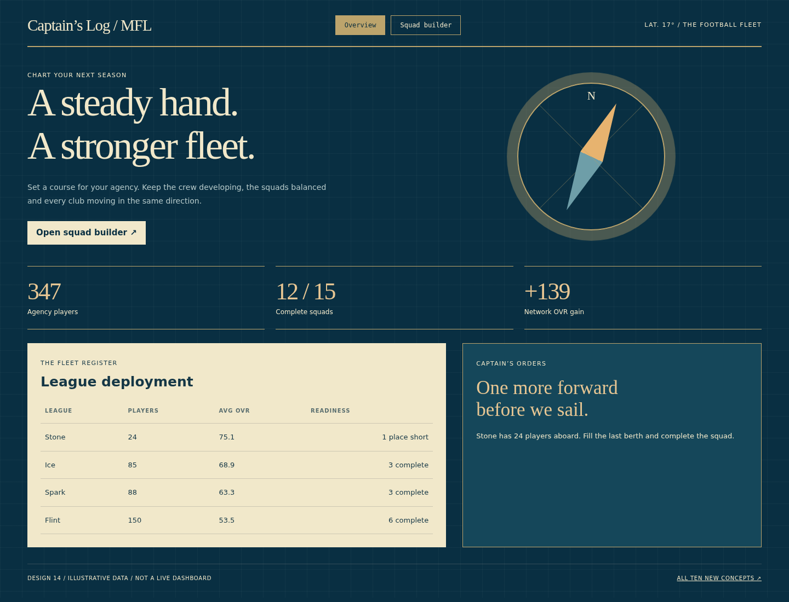
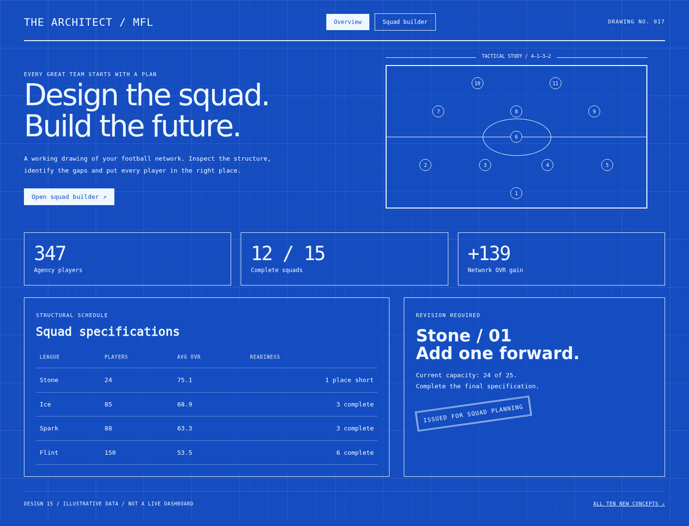
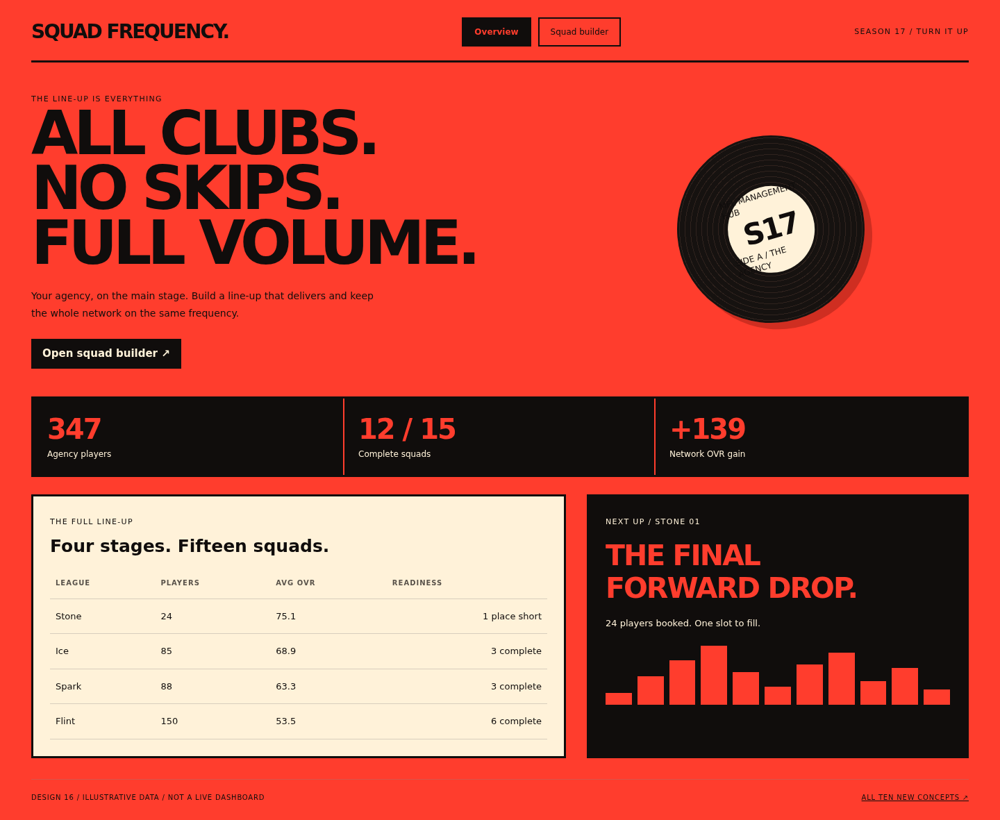

# Ten wild new MFL website themes

Ten new concepts, numbered **07–16** so they stay distinct from the original six. These are interactive design previews using illustrative data; the current live theme is Manager 95; the other designs remain previews.

[Open the PDF lookbook](MFL_Wild_Design_Lookbook.pdf) · [Download the offline gallery](MFL_Wild_Design_Gallery.zip)

**In the Hub:** open page **999 Design Studio**, choose **Ten new · Wild collection**, then select a theme. Switch to **Original six** to revisit the earlier concepts.

**Offline:** download and extract the ZIP, then open `wild-index.html`. GitHub previews HTML as source; screenshots below and the PDF can be viewed directly on GitHub.

## 07 · Manager 95

**A football desktop from 1995.** Grey bevelled windows, teal desktop wallpaper, a Start bar and a manager’s inbox.

[Mobile preview](previews/07-windows95-mobile.png) · [HTML source](07-windows95.html)

## 08 · Extra Time Arcade

**Insert coin. Build squad..** Purple arcade cabinets, pixel sprites, score counters and a loud yellow marquee.

[Mobile preview](previews/08-arcade-mobile.png) · [HTML source](08-arcade.html)

## 09 · Orbital FC

**Football in deep space.** An orbital mission display with planetary graphics, black space and burnt-orange telemetry.

[Mobile preview](previews/09-orbital-mobile.png) · [HTML source](09-orbital.html)

## 10 · Wabi Sabi

**Quiet Japanese minimalism.** Vermilion, white space, vertical typography and a restrained asymmetrical composition.

[Mobile preview](previews/10-wabi-mobile.png) · [HTML source](10-wabi.html)

## 11 · Offside Zine

**A football fanzine gone rogue.** Acid green, pink photocopy blocks, cut-out headlines, tape and deliberately unruly cards.

[Mobile preview](previews/11-zine-mobile.png) · [HTML source](11-zine.html)

## 12 · Bubble League

**A very unserious football universe.** Candy pink, sky blue, oversized pill shapes and a cheerful illustrated football.

[Mobile preview](previews/12-bubble-mobile.png) · [HTML source](12-bubble.html)

## 13 · The Final Third

**A football noir dossier.** Black and white, cinematic serif headlines, evidence notes and film-strip framing.

[Mobile preview](previews/13-noir-mobile.png) · [HTML source](13-noir.html)

## 14 · Captain’s Log

**Run your agency like a fleet.** Deep ocean blue, cream navigation charts, compass drawings and a captain’s roster.

[Mobile preview](previews/14-nautical-mobile.png) · [HTML source](14-nautical.html)

## 15 · The Architect

**Draw up the next great team.** Engineering blueprints, white linework, dimension markers and a tactical construction plan.

[Mobile preview](previews/15-blueprint-mobile.png) · [HTML source](15-blueprint.html)

## 16 · Squad Frequency

**A football warehouse party.** Signal red, black, giant typography, festival line-ups and a static audio-spectrum graphic.

[Mobile preview](previews/16-rave-mobile.png) · [HTML source](16-rave.html)

## Notes

Navigation to the squad preview, league selection and player search work in every concept. Other dashboard figures and decorative charts are illustrative. Animations and flashing effects are deliberately absent. Local fonts and their licences are included in `assets/`.